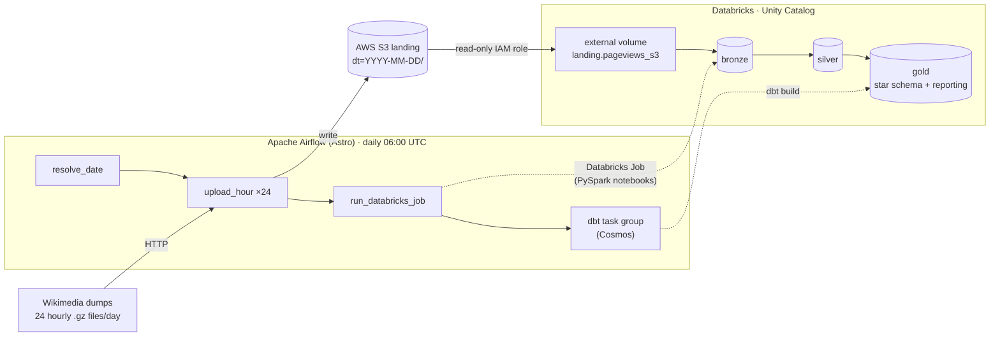

# Wikipedia Pageviews Lakehouse

Daily batch pipeline that loads hourly Wikimedia pageview dumps into an S3 landing zone, processes them on Databricks with PySpark and Delta Lake (bronze → silver), and builds a tested dimensional model with dbt (gold). The whole flow is orchestrated by Apache Airflow.

**Volume:** ~1.3 GB of compressed dumps and ~125–145 million rows per day.

## Architecture



### Daily run (`wiki_pageviews_daily`, 06:00 UTC)

1. **`resolve_date`** – data date = logical date − 1 day. Today or future dates are rejected, so only complete days are processed.
2. **`upload_hour` ×24** – dynamically mapped task per hour. Streams each dump from Wikimedia straight to S3 (no local disk). Files already in S3 are skipped. A missing file (HTTP 404) fails immediately; rate limiting (HTTP 429) is retried with exponential backoff. Max 2 parallel downloads.
3. **`run_databricks_job`** – triggers the Databricks Job with `process_date` and waits in deferrable mode (the worker slot is released while the job runs).
4. **`dbt`** – Astronomer Cosmos renders every dbt seed, model and test as a separate Airflow task, following the dbt dependency graph.

## Data layers

| Layer | Object | Built by | Grain | Load strategy |
|---|---|---|---|---|
| Landing | `s3://…/pageviews/dt=YYYY-MM-DD/pageviews-YYYYMMDD-HH0000.gz` | Airflow | one file per hour | skip if exists |
| Bronze | `workspace.bronze.pageviews_raw` | PySpark | one row per line of a source file, plus `_source_file`, `_ingested_at` | `replaceWhere` on source file name |
| Silver | `workspace.silver.pageviews` | PySpark | project (`domain_code`) × page × hour (UTC) | `replaceWhere` on `view_date` |
| Gold | `fact_pageviews_hourly` | dbt | project × page × hour | incremental, `replace_where` on `date_key` |
| Gold | `dim_project`, `dim_page`, `dim_date`, `dim_hour` | dbt | one row per member | full rebuild |
| Gold | `top_articles_hourly` | dbt | date × hour × rank (top 100) | incremental, `replace_where` on `date_key` |

### Dimensional model

- **`fact_pageviews_hourly`** – view counts keyed by `date_key` (yyyyMMdd), `hour_key`, `project_key`, `page_key`.
- **`dim_project`** – one row per `domain_code`. Language, project family (Wikipedia, Wiktionary, …) and platform (desktop / mobile) are derived from the code using seed tables.
- **`dim_page`** – one row per site and page title. Desktop and mobile versions of a page share one key. Namespace and `is_article` come from a namespace seed.
- **`dim_date`** (2026–2027) and **`dim_hour`** (0–23, UTC, with part of day) – generated, not loaded from source.
- **`top_articles_hourly`** (reporting) – the 100 most viewed Polish Wikipedia articles per hour, desktop and mobile combined, built on top of the star schema.

## Tech stack

| Area | Tools |
|---|---|
| Orchestration | Apache Airflow 3 (Astro CLI, Astro Runtime), Astronomer Cosmos |
| Processing | Databricks (serverless), PySpark, Delta Lake |
| Modelling | dbt (dbt-databricks), dbt_utils |
| Storage and governance | AWS S3, Unity Catalog (storage credential, external location, external volume) |
| Security | AWS IAM (least-privilege user for Airflow, read-only role for Databricks) |
| Code quality | dbt tests, ruff |

## Repository structure

```
airflow/
  dags/wiki_pageviews_daily.py      Airflow DAG
  include/wiki_s3.py                download and S3 upload helpers
  include/dbt/wiki_pageviews/       dbt project (staging, marts, reporting, seeds, tests)
  Dockerfile                        Astro Runtime + dbt in an isolated virtualenv
  .env.example                      connections and variables required by the DAG
notebooks/
  02_landing_to_bronze.py           S3 volume → bronze
  03_bronze_to_silver.py            bronze → silver
infra/jobs/wiki_pageviews_daily.yml Databricks Job definition (Asset Bundle format)
setup/                              schemas, external volume, table comments
ruff.toml                           lint and format settings
```

## Design decisions

- **Landing zone in an S3 bucket owned outside Databricks.** Raw files are independent of the processing engine and can be read by other tools (for example Athena). Databricks reaches the bucket through Unity Catalog with an IAM role that is **read-only**: only Airflow can write raw data, so a faulty notebook cannot damage the source of truth.
- **Downloads run in Airflow, not in Spark.** Downloading files over HTTP does not benefit from distributed compute. A lightweight worker is cheaper and gives per-hour status, retries and skipping.
- **`replaceWhere` instead of `MERGE`.** Each run produces a complete day, so the day is replaced atomically. On this data `MERGE` took over three minutes even when nothing changed.
- **Bronze identifies a day by the file name, not the folder path.** The name (`pageviews-YYYYMMDD-HH0000.gz`) is the same in any landing layout, so moving the landing zone did not leave duplicate rows behind.
- **Every step is idempotent.** Re-running a day skips existing files, replaces the same day in bronze, silver and gold, and produces identical row counts.
- **Airflow orchestrates systems, the Databricks Job orchestrates notebooks.** Airflow sees the job as one task; notebook order, logs and repair runs stay in Databricks.
- **dbt through Cosmos.** Each model and test is a separate Airflow task, so a failing test points to the exact model and blocks only what depends on it. Tests with several parents (for example `relationships` from the fact to a dimension) run as separate tasks after all their parents are built.
- **dbt in its own virtualenv** inside the Airflow image, to avoid dependency conflicts with Airflow.
- **Separate dev and prod targets.** Local development builds into `workspace.dbt_dev`; Airflow builds into `workspace.gold`. Both use the same dbt project.

## Data quality

- **30 dbt tests:** `unique`, `not_null`, `accepted_values`, `relationships` between the fact and every dimension, `dbt_utils.unique_combination_of_columns` on the fact grain, `dbt_utils.accepted_range` on ranks.
- **Reconciliation test:** total views in the fact must equal total views in staging.
- **Fail-fast checks in Airflow:** future data dates and missing source files stop the run without retries.

## Running locally

**Prerequisites:** Docker, [Astro CLI](https://www.astronomer.io/docs/astro/cli/install-cli), a Databricks workspace with Unity Catalog and a SQL warehouse, an AWS account with an S3 bucket.

1. **Databricks setup**
   - Create a storage credential (IAM role with read-only access to the bucket) and an external location for the bucket.
   - Run `setup/00_create_schemas.sql` and `setup/01_table_comments.sql`.
   - Create the job from `infra/jobs/wiki_pageviews_daily.yml` (Databricks Asset Bundles) and keep its schedule paused; Airflow triggers it.
2. **Airflow**
   ```bash
   cd airflow
   cp .env.example .env      # fill in AWS keys, Databricks host, token and SQL warehouse path, bucket name
   astro dev start           # UI at http://localhost:8080
   ```
   Unpause `wiki_pageviews_daily` or trigger it manually. To load a range of past days:
   ```bash
   astro dev run backfill create --dag-id wiki_pageviews_daily --from-date 2026-10-20 --to-date 2026-10-22
   ```
3. **dbt development** – install `requirements.txt`, configure a `dev` target in `~/.dbt/profiles.yml` (schema `dbt_dev`), then from `airflow/include/dbt/wiki_pageviews`:
   ```bash
   dbt deps
   dbt build --select top_articles_hourly --vars "{process_date: '2026-11-12'}"
   ```

## Limitations and next steps

- Airflow runs locally; production would use a managed service (Astro or Amazon MWAA).
- Databricks access uses personal access tokens; production would use a service principal with OAuth.
- Dev and prod are separated by schema in one catalog; production would use separate catalogs.
- No CI/CD yet: `ruff`, `astro dev parse` and `dbt build` on a pull request are the next step.
- `dim_date` covers 2026–2027 and the namespace list is a static seed; both could be generated (the namespaces from the MediaWiki API).
